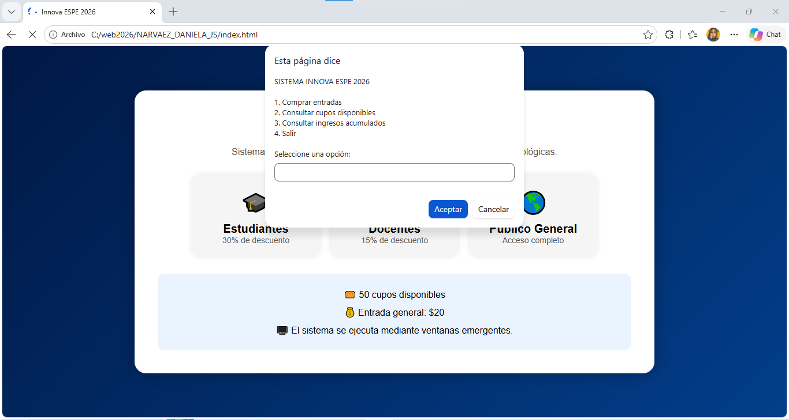
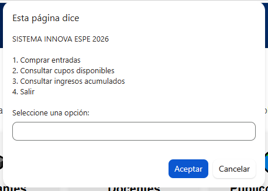
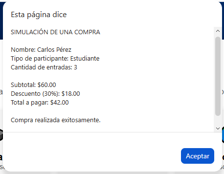
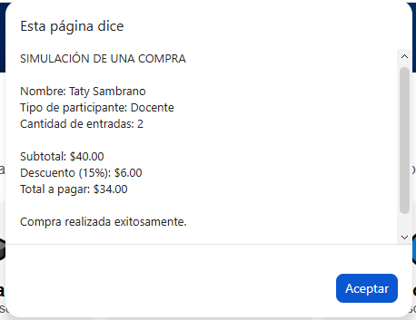
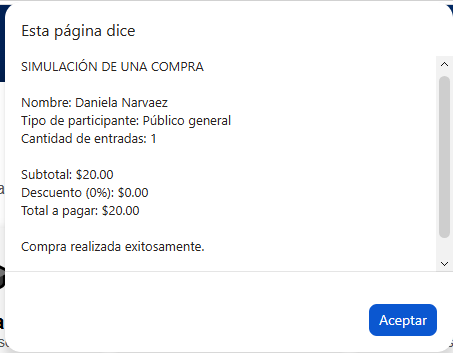
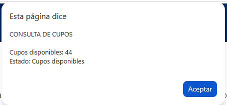
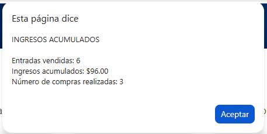

# 🎟️ Sistema de Gestión de Entradas - Innova ESPE 2026

## 👨‍💻 Autor

**Daniela Mabel Narváez Suntaxi**  
Ingeniería de Software  
Universidad de las Fuerzas Armadas ESPE

---

## 📌 Descripción

El proyecto consiste en el desarrollo de un sistema básico de gestión de entradas para el evento tecnológico ficticio **Innova ESPE 2026**.

El sistema permite registrar compras de entradas, aplicar descuentos según el tipo de participante, controlar los cupos disponibles y consultar los ingresos acumulados del evento.

La aplicación fue desarrollada utilizando:

- HTML5
- CSS3
- JavaScript Nativo

La interacción se realiza mediante:

- `prompt()`
- `alert()`
- `console.log()`

---

## 🎯 Objetivos

- Controlar la venta de entradas.
- Aplicar descuentos según el participante.
- Gestionar los cupos disponibles.
- Mostrar ingresos acumulados.
- Validar datos ingresados por el usuario.

---

## ⚙️ Funcionalidades Implementadas

### RF01. Configuración Inicial

- Precio por entrada: $20
- Cupos iniciales: 50
- Descuento estudiante: 30%
- Descuento docente: 15%
- Descuento público general: 0%
- Máximo 5 entradas por compra

---

### RF02. Menú Principal

El sistema presenta las siguientes opciones:

1. Comprar entradas
2. Consultar cupos disponibles
3. Consultar ingresos acumulados
4. Salir

---

### RF03. Compra de Entradas

Permite:

- Registrar el nombre del comprador.
- Seleccionar el tipo de participante.
- Ingresar la cantidad de entradas.
- Validar los datos ingresados.
- Aplicar descuentos.
- Actualizar los cupos del evento.

---

### RF04. Consulta de Cupos

Permite visualizar:

- Cupos disponibles.
- Estado del evento.

Mensajes:

- Más de 10 cupos → Cupos disponibles.
- Entre 1 y 10 → Últimos cupos disponibles.
- 0 cupos → Evento agotado.

---

### RF05. Consulta de Ingresos

Permite visualizar:

- Total de entradas vendidas.
- Total de ingresos acumulados.
- Número de compras realizadas.

---

### RF06. Finalización

Muestra un resumen general del evento antes de terminar la ejecución.

---

# 🖼️ Capturas de Pantalla

## Página Principal




---

## Menú Principal




---

## Compra Exitosa como Estudiante

### Datos de entrada

- Nombre: Carlos Pérez
- Tipo: Estudiante
- Entradas: 3

### Resultado esperado

- Subtotal: $60.00
- Descuento: $18.00
- Total a pagar: $42.00



---

## Compra Exitosa como Docente

### Datos de entrada

- Entradas: 2

### Resultado esperado

- Total a pagar: $34.00



---

## Compra Exitosa Público General

### Datos de entrada

- Entradas: 1

### Resultado esperado

- Total a pagar: $20.00



---

## Consulta de Cupos



---

## Consulta de Ingresos



# ✅ Casos de Prueba

| Escenario | Resultado Esperado |
|------------|-------------------|
| Estudiante - 3 entradas | $42 |
| Docente - 2 entradas | $34 |
| Público general - 1 entrada | $20 |
| Solicitud de 0 entradas | Compra rechazada |
| Solicitud de 6 entradas | Compra rechazada |
| Texto en lugar de cantidad | Compra rechazada |
| Solicitud superior a cupos | Compra rechazada |
| Opción inválida del menú | Mensaje de error |
| Opción 4 | Finalizar sistema |

---

# 📂 Estructura del Proyecto

```text
NARVAEZ_DANIELA_JS
│
├── index.html
├── README.md
│
├── css
│   └── style.css
│
├── js
│   └── app.js
│
└── img
    ├── principal.png
    ├── menu.png
    ├── compra-estudiante.png
    ├── compra-docente.png
    ├── compra-publico.png
    ├── cupos.png
    └── ingresos.png
```

---

# 🚀 Ejecución

1. Descargar o clonar el repositorio.
2. Abrir el archivo `index.html`.
3. Interactuar con el sistema mediante las ventanas emergentes.
4. Revisar la consola del navegador con `F12` para observar los mensajes registrados.

---

# 📑 Tecnologías Utilizadas

- HTML5
- CSS3
- JavaScript

---

# 📋 Conclusiones

- Se desarrolló un sistema funcional de gestión de entradas utilizando JavaScript nativo.
- Se aplicaron estructuras de control, variables, funciones y validaciones.
- Se implementó correctamente el cálculo de descuentos y control de cupos.
- El proyecto permitió reforzar conceptos de desarrollo web básico y uso de GitHub para control de versiones.

# 📜 Historial de Desarrollo del Proyecto

El desarrollo del sistema se gestionó mediante Git y GitHub, registrando cada cambio importante mediante commits descriptivos. Cada commit representa una mejora específica realizada durante la construcción del proyecto. 【1-75910a】

## 🚀 Línea de Tiempo de Commits

### ✅ Commit 1 - Inicio del Proyecto
**35dd75c** - `Initial commit`

- Creación inicial del repositorio.
- Configuración de la estructura base del proyecto.
- Preparación de archivos para el desarrollo.

---

### ✅ Commit 2 - Implementación del Sistema
**f672714** - `Sistema Innova ESPE 2026 completo`

- Desarrollo de la lógica principal en JavaScript.
- Implementación del menú interactivo.
- Registro de compras.
- Cálculo de descuentos.
- Control de cupos disponibles.
- Consulta de ingresos acumulados.

---

### ✅ Commit 3 - Sincronización con GitHub
**1538f1e** - `Merge branch 'main'`

- Integración del repositorio local con GitHub.
- Sincronización de cambios entre entornos.

---

### ✅ Commit 4 - Mejora Visual de la Interfaz
**4cae661** - `Mejorar interfaz visual de la pagina principal`

- Incorporación de estilos visuales.
- Mejora de la presentación de la página principal.
- Organización visual de la información.

---

### ✅ Commit 5 - Optimización del Diseño
**82338b5** - `Mejorar diseño visual de la pagina principal`

- Ajustes de colores y distribución.
- Mejora de la experiencia visual del usuario.
- Diseño más atractivo y moderno.

---

### ✅ Commit 6 - Documentación del Proyecto
**4a00f3e** - `Agregar documentacion y capturas del proyecto`

- Elaboración del README.
- Inclusión de capturas de pantalla.
- Documentación de funcionalidades.
- Evidencia del funcionamiento del sistema.

---

## 📷 Evidencia del Historial de Commits

img/historial-commits.png

---

## 📊 Resumen

| Métrica | Valor |
|----------|----------|
| Total de commits | 6 |
| Lenguaje principal | JavaScript |
| Control de versiones | Git |
| Plataforma de repositorio | GitHub |
| Estado del proyecto | ✅ Finalizado |